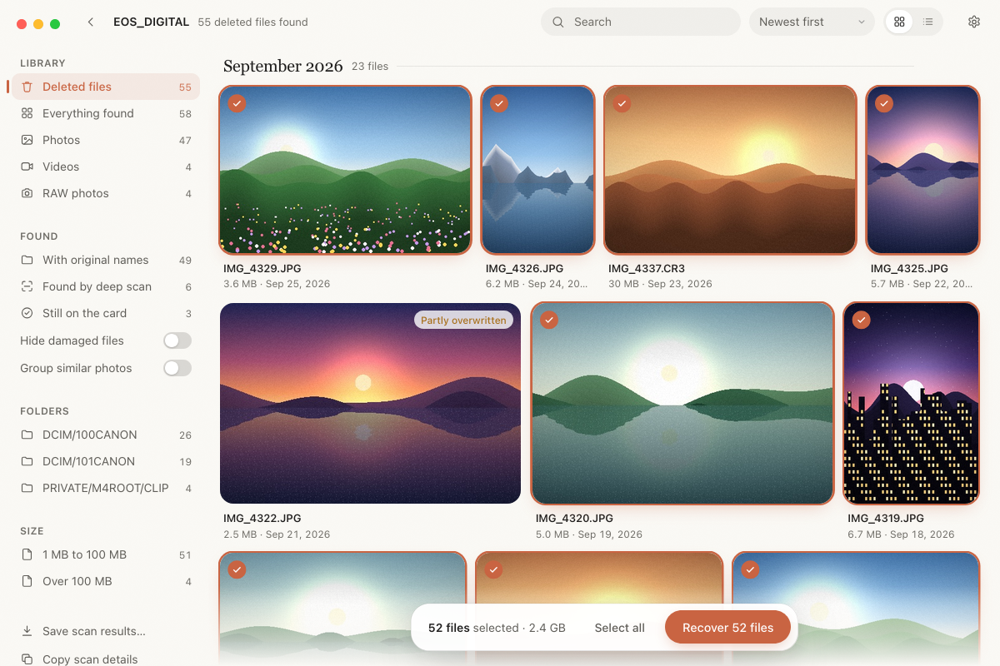
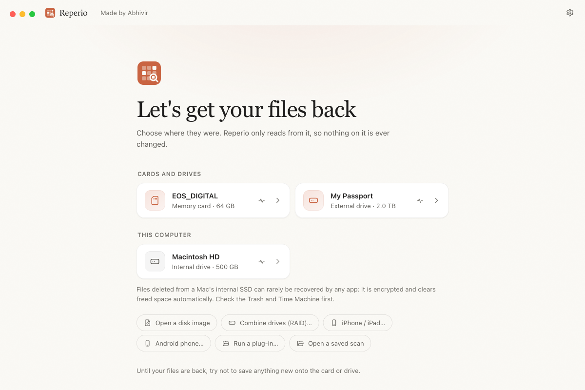
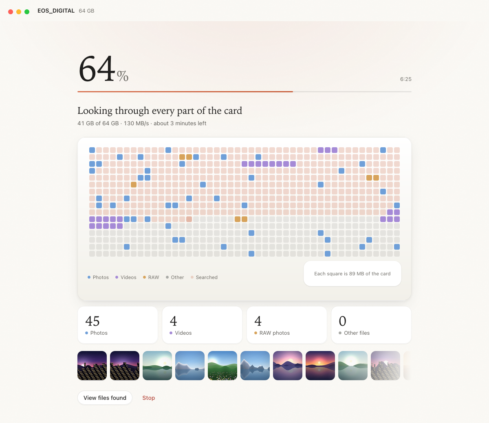
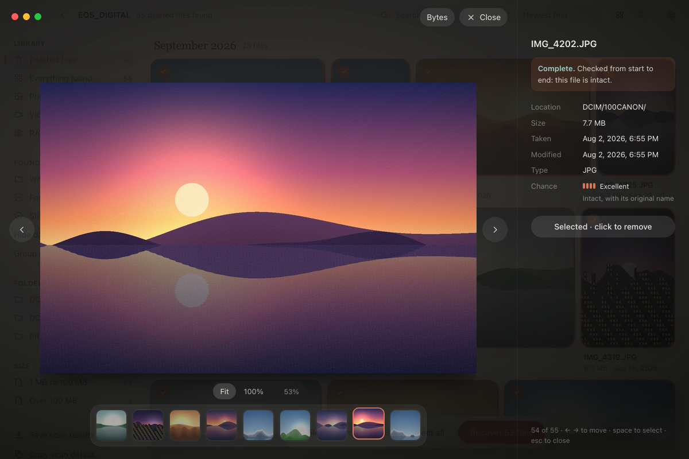
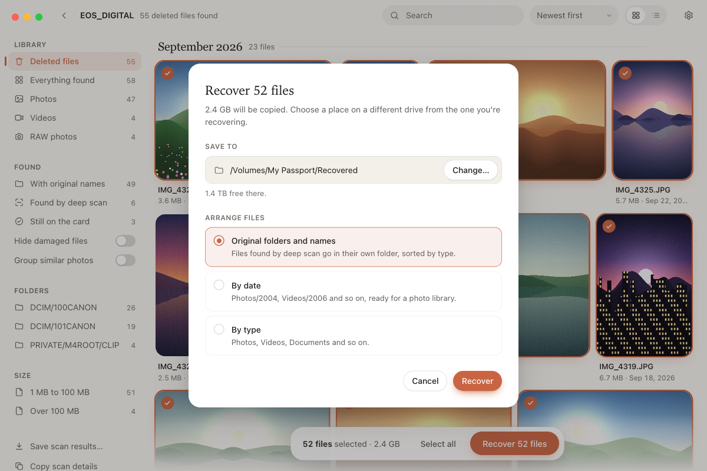

# Reperio

*Reperio* is Latin for "I find again". It recovers deleted photos, videos
and files from memory cards, USB drives, disks and disk images, including
after an accidental delete or a quick format.

<p align="center">
  
</p>

- **Original names, folders and dates.** Reperio reads the card's filesystem
  (FAT12/16/32 and exFAT, which nearly every camera and memory card uses;
  NTFS, common on external drives formatted on Windows; Mac OS Extended
  (HFS+) and APFS, for cards and drives formatted on a Mac; and ext2, ext3
  and ext4, for Linux drives and Raspberry Pi cards), so
  deleted files come back as `DCIM/100CANON/IMG_0001.JPG`, not `f1234567.jpg`.
  It even works out the first letter that FAT deletion erases from short
  names.
- **Deep scan after a format.** It searches every free sector for photos and
  videos by walking each format's internal structure. That way files come
  back at their exact size, and random data that merely looks like a file
  header is rejected.
- **Rebuilds files stored in pieces.** Free space is carved as one stitched
  stream, so photos and videos written around files still on the card come
  back whole. After a format, photos split in two are rejoined by trying
  candidate layouts until the image checks out from start to end, and videos
  by finding their index and checking every frame's position in each piece.
- **Checks every file.** Each recovered photo or video is verified from start
  to end and marked *complete*, *damaged* or *partly overwritten*, so you know
  what you are getting before you recover it.
- **Never writes to the card.** The disk being recovered is only ever opened
  read-only, and Reperio refuses to save recovered files onto it.

## The app

Choose the card, watch the scan as photos appear, browse what was found by
month, folder or year, preview photos and videos, and recover them to a
folder of your choice: in their original folders, sorted by date, or sorted
by type. Every file's modification date is set to when it was taken, so
Photos and Finder sort recovered files correctly.

### Install it on a Mac

```bash
git clone https://github.com/abhivirchaudhary/Reperio.git
cd Reperio
scripts/build-mac-app.sh --install
```

That builds `Reperio.app` and a `.dmg` installer, puts the app in
`/Applications` (or in `~/Applications` if you can't write there) and opens
it. The first build takes several minutes; to update later, run `git pull` and
then the command again. It needs the Xcode command line tools and [Rust](https://rustup.rs),
and says how to get either if it is missing. The Tauri build tool it installs
itself, once.

Without `--install` it only builds, leaving
`target/universal-apple-darwin/release/bundle/macos/Reperio.app` and the
`.dmg` next to it in `bundle/dmg/`. `INSTALL_DIR=~/Applications` installs
somewhere else, and `NO_OPEN=1` installs without opening the app.

The app is a universal build: it runs natively on Apple silicon (M1 and later)
and on Intel Macs with macOS 11 or newer. The Mac you give the `.dmg` to needs
nothing installed: Rust and the build tools are only needed to build it.
If the copy came over AirDrop, a download or a USB stick and macOS says the
app "is damaged", run `xattr -dr com.apple.quarantine /Applications/Reperio.app`
once in Terminal.

The app is not signed with an Apple Developer ID, so on a Mac the `.dmg` was
copied to, the first time you open it macOS will block it. Go to
**System Settings → Privacy & Security**, find the message about Reperio, and
click **Open Anyway**.

#### Signing and notarizing (for sharing Reperio)

With an Apple Developer account, the app can be signed and notarized so it
opens without warnings on any Mac and keeps its Full Disk Access across
updates:

1. In Xcode (Settings → Accounts → Manage Certificates) create a
   **Developer ID Application** certificate.
2. Create an app-specific password at appleid.apple.com.
3. Build with:
   ```bash
   export APPLE_SIGNING_IDENTITY="Developer ID Application: Your Name (TEAMID)"
   export APPLE_ID="you@example.com" APPLE_PASSWORD="app-specific-password" APPLE_TEAM_ID="TEAMID"
   scripts/build-mac-app.sh
   ```

The CI workflow does the same when the repository has the secrets
`APPLE_CERTIFICATE` (the exported .p12, base64), `APPLE_CERTIFICATE_PASSWORD`,
`APPLE_SIGNING_IDENTITY`, `APPLE_ID`, `APPLE_PASSWORD` and `APPLE_TEAM_ID`.
Automatic updates build on this: they need a signed build and a public place to
publish releases.

macOS also protects memory cards: no app can read one directly, even with
your password, until you allow it. In **System Settings → Privacy & Security →
Full Disk Access**, turn on **Reperio** (click **+** to add it if it isn't
listed), then quit and reopen Reperio. Reperio shows these steps, with a
button to the right page, the first time it needs them. Because the app is not
Developer ID signed, macOS ties this permission to each build: after
rebuilding, remove Reperio from the list and add it again. For the
command-line tool, give Terminal Full Disk Access instead.

### Using it

1. **Stop using the card.** Don't take photos with it or copy anything onto
   it. On an SD card, slide the lock switch down.
2. Insert the card and open Reperio. The card is listed first.
3. Click it. macOS asks for your password: reading a card directly needs
   administrator rights. Reperio unmounts the card first, so the Mac can't
   write to it during the scan.
4. When the scan finishes, every deleted file in good condition is already
   selected. Double-click to preview, then click **Recover** and choose a
   folder on your Mac (not on the card).

If the card is failing (disconnects, very slow, read errors), use **Back up
the whole card…** in the sidebar, then open the backup with **Open a disk
image…** and recover from that instead. The backup copies healthy areas
first and damaged ones after (see [Imaging a failing card](#imaging-a-failing-card)).
If it is stopped, backing up to the same file again carries on where it left
off.

## Screens

*The screenshots show a sample memory card.*

**Choose where your files were.** Cards and drives show up as soon as they are plugged in. Reperio only reads from them.



**Watch the scan.** The map shows every part of the card as it is searched, with photos, videos and RAW files marked where they were found and the latest photos below it.



**Check before you recover.** Every file is verified from start to end, and the panel says how likely it is to come back whole.



**Recover.** Choose a folder on a different drive, and whether to keep the original folders or sort by date or type.



## The command-line tool

The same engine is available as `reperio`:

```bash
cargo build --release -p reperio
diskutil list                         # find the card, e.g. /dev/disk4
diskutil unmountDisk /dev/disk4
sudo ./target/release/reperio scan /dev/rdisk4 -o ~/Desktop/Recovered
```

| Option | What it does |
|---|---|
| `--list` | Show what was found without saving anything |
| `--layout original\|by-date\|by-type` | How to arrange recovered files (default: original folders) |
| `--quick` | Only read the filesystem; skip the deep scan |
| `--existing` | Also recover files that were never deleted |
| `--damaged` | Also recover damaged and partly overwritten files |
| `--types jpeg,mp4` | Deep-scan only some formats: `jpeg`, `mp4`, `raw`, `png`, `avi`, `mts`, `mkv`, `mp3`, `zip`, `pdf`, `gif`, `bmp`, `psd` |
| `--save scan.reperio` | Save the results to open in the app later |
| `--find-partitions` | Search every sector for partitions deleted or lost from the partition table (the likely places outside readable volumes are always searched) |

### Imaging a failing card

A card that is failing can get worse with every read, so copy it once to an
image file and recover from the copy:

```bash
sudo ./target/release/reperio image /dev/rdisk4 card.img
sudo ./target/release/reperio scan card.img -o ~/Desktop/Recovered
```

`reperio image` works like GNU ddrescue and never writes to the card:

1. **Copy:** reads the card in 1 MiB pieces. When a read fails it marks that
   piece and jumps ahead, further after each failure in a row, so the healthy
   areas are copied before the card has a chance to give out. Whatever was
   jumped over is read in a second sweep.
2. **Trim:** reads each failed piece from both ends one sector at a time,
   until a sector fails.
3. **Scrape:** reads what is left in the middle of each failed piece, sector
   by sector.
4. **Retry** (with `--retries N`): goes back over sectors that still failed.

The image is the card's exact size, with each sector at its own offset;
sectors that could not be read are left as zeros. Progress is kept in a map
file (`card.img.map` by default) in ddrescue's format, so you can stop with
Ctrl-C at any point and carry on later with `--resume`, inspect the map with
`ddrescuelog -t card.img.map`, or hand it to `ddrescue` itself.

| Option | What it does |
|---|---|
| `--resume` | Continue an earlier copy into the same image, from its map |
| `--map FILE` | Keep the map somewhere else (default: the image name plus `.map`) |
| `--retries N` | Go back over unreadable sectors N more times at the end |
| `--reverse` | Do those retries from the end of the card towards the start |
| `--no-scrape` | Skip the slow sector-by-sector scrape for now; a later `--resume` does it |

At the end it lists the unreadable areas by byte and sector.

#### Forensic imaging

For evidence, add any of the forensic options and the finished image is
hashed (MD5, SHA-1 and SHA-256), and an acquisition report is written next to
it as `card.img.report.txt` and `.json`:

```bash
sudo reperio image /dev/sdb evidence.img --case 2026-0042 --examiner "A. Examiner" \
    --evidence "Item 3: 64 GB SD card" --notes "seized 12 Oct" --verify --split 2G
```

The report records the case details, the drive's model, serial number,
firmware and sector size, the tool and its version, start and end times
(UTC), each pass and what it did, every unreadable sector, the hashes of the
whole image and of each segment, and that the source was opened read-only.
`--verify` reads the drive a second time and compares it with the image
(sectors already found unreadable are taken as zeros, not read again); if
anything differs the report names the sectors and the exit code is 2.
`--split 2G` writes `evidence.img.001`, `.002`, ... for FAT32 drives or
archiving. The hashes are computed from the finished image, because the copy
itself writes out of order. The app's "Back up the whole drive" sheet has the
same options under "Forensic report".

### Recovering from a computer that will not start

`scripts/make-rescue-usb.sh` builds a bootable USB stick (BIOS and UEFI, PCs
and Intel Macs) that starts a small Linux straight into `reperio menu`, a
step-by-step text menu: pick the internal drive, scan it, choose what to bring
back, pick another drive to save onto, recover. See
[docs/rescue-usb.md](docs/rescue-usb.md).

### Drives from a RAID set

Drives from a dead NAS (Synology and QNAP use Linux md), a RAID enclosure or
a striped Windows or Mac volume can be combined into one virtual drive and
scanned like any other. Reperio reads JBOD, RAID 0, 1, 5 (all four md parity
layouts) and md RAID 10, and rebuilds a missing or unreadable RAID 5 drive
from the others.

```bash
reperio raid /dev/sdb /dev/sdc /dev/sdd              # show how they fit together
reperio raid disk1.img disk2.img disk3.img --missing 1
sudo reperio scan --raid /dev/sdb,/dev/sdc,/dev/sdd -o ~/Recovered
```

With Linux md superblocks (versions 0.90, 1.0, 1.1 and 1.2) on the drives the
layout is exact. Without them, Reperio tries chunk sizes from 4 KiB to
1 MiB, member orders and parity layouts, and scores each by what the
combined drive looks like: partition tables and file systems at the start,
FAT copies and folder entries, NTFS records that carry their own numbers,
ext backup superblocks, and whether the files it lists read whole. Give
`--level`, `--chunk`, `--parity`, `--order 2,1,-,3` (`-` is a missing drive)
or `--offset 1M` to narrow the search when you know them. In the app, use
"Combine drives (RAID)" on the home page.

## What it recovers

**By filesystem (any file type, with names):** FAT12, FAT16, FAT32, exFAT,
NTFS, Mac OS Extended (HFS+, journaled or not), APFS, and ext2, ext3 and
ext4, on MBR, GPT or unpartitioned media.

- **Mac OS Extended:** a deleted file's catalog record usually survives in the
  journal, in unused catalog nodes or at the end of a node, and gives back its
  name, folder, dates and exact location.
- **APFS** never overwrites its directory records in place: each change writes
  new copies and leaves the old ones in free space. The deep scan picks those
  old copies up as it goes, so deleted files come back with their names, even
  after the card has been erased, as long as nothing has been written over
  them since. Encrypted APFS volumes can't be read without their password.
- **ext3 and ext4** erase a deleted file's size and block map, but first
  write a copy of every changed block to the journal, where it stays until
  the journal comes round again. Reperio finds the deleted file's inode in
  those copies, block map and dates intact (extent trees of any depth, block
  pointers, small files stored inside the inode), and its name in the
  folder entry left behind on the disk or in an old copy of the folder in
  the journal. Files whose name is gone come back in `Lost files`. On
  ext2, which has no journal, files come back when the inode was freed
  without erasing its block pointers (as e2fsprogs and older drivers do;
  current Linux erases them, leaving only the name). Encrypted files
  (Android's file-based encryption) are skipped.

**By deep scan:**

| Group | Files |
|---|---|
| `jpeg` | JPEG photos (baseline and progressive), dated from EXIF; split photos rejoined |
| `mp4` | MP4, MOV, HEIC, AVIF, Canon CR3, 3GP, M4A; videos dated from their header; split videos rejoined |
| `raw` | Camera RAW (CR2, NEF, ARW, DNG, ORF, RW2, PEF) and TIFF, dated from EXIF |
| `png` | PNG images |
| `avi` | AVI video (including over 1 GB), WebP, WAV |
| `mts` | AVCHD camcorder video (MTS/M2TS) |
| `mkv` | Matroska and WebM video |
| `mp3` | MP3 audio |
| `zip` | Word, Excel and PowerPoint documents, OpenDocument, EPUB, ZIP archives |
| `pdf` | PDF documents, including edited ones |
| `ole` | Word, Excel and PowerPoint documents from before 2007 (DOC, XLS, PPT), Outlook messages (MSG), Visio drawings, Windows installers and other OLE2 compound files |
| `pst` | Outlook mailboxes and offline caches (PST, OST), Unicode and older ANSI |
| `rar`, `7z` | RAR (versions 4 and 5, including volumes) and 7-Zip archives |
| `sqlite` | SQLite databases, as kept by phones, browsers and apps |
| `mxf` | MXF professional video (Sony, Canon, Panasonic cameras) |
| `asf` | Windows Media video and audio (WMV, WMA, ASF), dated from their header |
| `flac` | FLAC audio |
| `font` | TrueType and OpenType fonts and font collections (TTF, OTF, TTC) |
| `gif`, `bmp`, `psd` | GIF, BMP and Photoshop (PSD/PSB) images |

Fujifilm RAF is carved under `raw`.

**Video repair.** A video that won't play because its index is missing (a
recording cut short when the battery died or the card was pulled, or a
recovered video whose end was lost) is rebuilt automatically, using an intact
video from the same card as a guide: its frames are found by walking the H.264
or H.265 stream, put back in display order, and given a new index. Repaired
videos are marked as such and play without sound. From the command line:
`reperio fix-video BROKEN.MP4 -r GOOD.MP4`.

**Recovery Vault.** In Settings, turn on protection for a card or drive. Reperio
then keeps a small record of its files (names, folders, sizes and a fingerprint
of each), refreshed whenever the drive is connected: on a Mac by a background
task that runs when a drive is mounted and every hour, without administrator
rights. If the files are later deleted or the drive formatted, files the deep
scan finds get their original names and folders back. From the command line:
`reperio vault /Volumes/CARD card.json`, then `reperio scan ... --vault card.json`.

## Limits worth knowing

- **Overwritten data is gone.** Photos taken after the delete may have reused
  the deleted files' space. Recover as soon as possible.
- **Internal Mac SSDs** are encrypted and erase freed space automatically
  (TRIM), so files deleted there are usually unrecoverable by any software.
  Memory cards, USB sticks and external hard drives are a different story.
- **Files split into more than two pieces after a format** are not rejoined
  yet; photos and videos split in two are.
- **Some files don't say how long they are**, and the deep scan won't guess:
  RAR archives with encrypted file names, archives from RAR 2 and earlier,
  and SQLite databases whose header was last written by a version
  from before 2010 are skipped.
- **Formatted ext2 and ext3 cards:** these keep blocks of pointers inside
  every file over 12 blocks, so after a format the deep scan cannot rebuild
  their photos and videos yet. ext4 is not affected. Once the journal has
  come round, deleted ext3/ext4 files lose their layout too.

## Plug-ins

Reperio can be extended with plug-ins: scripts or programs, in Python,
JavaScript, Rust, C and more, that read a new kind of drive, find files in a new
way or analyze what was found. The protocol is in [docs/plugins.md](docs/plugins.md),
and [plugins/](plugins/) has the SDK, templates and small examples for writing
your own.

The finished plug-ins, such as the Red Team forensic suite, are not published
here. To get them, open an issue or contact Abhivir Chaudhary through
[GitHub](https://github.com/abhivirchaudhary).

## How it's built

```
engine/        reperio-engine: everything that finds and recovers files
  source       read-only access to devices and images
  imaging      ddrescue-style copying of failing cards, with map files
  health       whether a drive reports itself as failing (SMART)
  forensic     hashes, verification and the acquisition report for imaging
  fs/          partition tables, FAT, exFAT, NTFS, HFS+, APFS and ext2/3/4 readers
  formats/     JPEG, ISO media (MP4/MOV/HEIC/CR3), TIFF/RAW, PNG, RIFF, MTS
  scan         the deep-scan loop
  repair       rejoining photos and videos stored in two pieces
  session      a full scan, validation, merging, saving, and recovery
  preview      thumbnails and previews
  remote       reading a device through the privileged helper
cli/           reperio: the command-line tool, and `reperio menu` for the rescue USB
app/           the desktop app (Tauri): src-tauri/ in Rust, ui/ in plain HTML/JS
plugins/       the plug-in SDK, templates and examples (the plug-ins themselves
               are not published here)
scripts/       test card generator, end-to-end checks, Mac build script,
               rescue USB builder (make-rescue-usb.sh, rescue/)
```

Reading a raw disk needs administrator rights, but the app never runs as
root. It starts a tiny helper through the system password prompt, and the
helper's only job is to answer "give me these bytes" for the one device it
was started for, opened read-only. All scanning and file writing stays in
the normal app.

### Tests

```bash
cargo test --workspace                                   # unit tests
sudo scripts/make_test_cards.py /tmp/cards               # FAT32, exFAT, NTFS, ext2/3/4, HFS+, APFS cards
REPERIO_TEST_CARDS=/tmp/cards cargo test --release -p reperio-engine --test cards
scripts/e2e_check.py /tmp/cards target/release/reperio   # delete, format, recover
sudo scripts/make_lost_cards.py /tmp/lost               # wiped, edited and replaced partition tables
REPERIO_LOST_CARDS=/tmp/lost cargo test --release -p reperio-engine --test cards lost
scripts/lost_check.py /tmp/lost target/release/reperio   # find lost partitions, recover
python3 scripts/forensic_check.py target/release/reperio # hashes, report, verification (needs FUSE)
sudo python3 scripts/menu_check.py target/release/reperio # the rescue menu, on loop devices
```

The test cards (FAT32, exFAT, NTFS; ext4 and ext3, written and deleted
from by the Linux kernel's own driver, so through its journal, and ext2,
deleted with e2fsprogs' debugfs; and Mac-formatted HFS+ and APFS, which
`scripts/hfsplus_card.py` and `scripts/apfs_card.py` build following Apple's
specifications, deleting through the Trash as the Finder does, and which are
cross-checked with libfshfs and libfsapfs) hold camera photos with EXIF dates,
videos, a deleted folder, long and accented file names, and a photo and a video
each written in two pieces around other files. The
end-to-end check recovers every deleted file byte for byte, then quick-formats
each card and recovers every photo and video again by deep scan alone
(except on ext2 and ext3, see above).
`app/tests/gui_e2e.py` drives the real app through a full recovery with
WebDriver.

MIT licensed.
